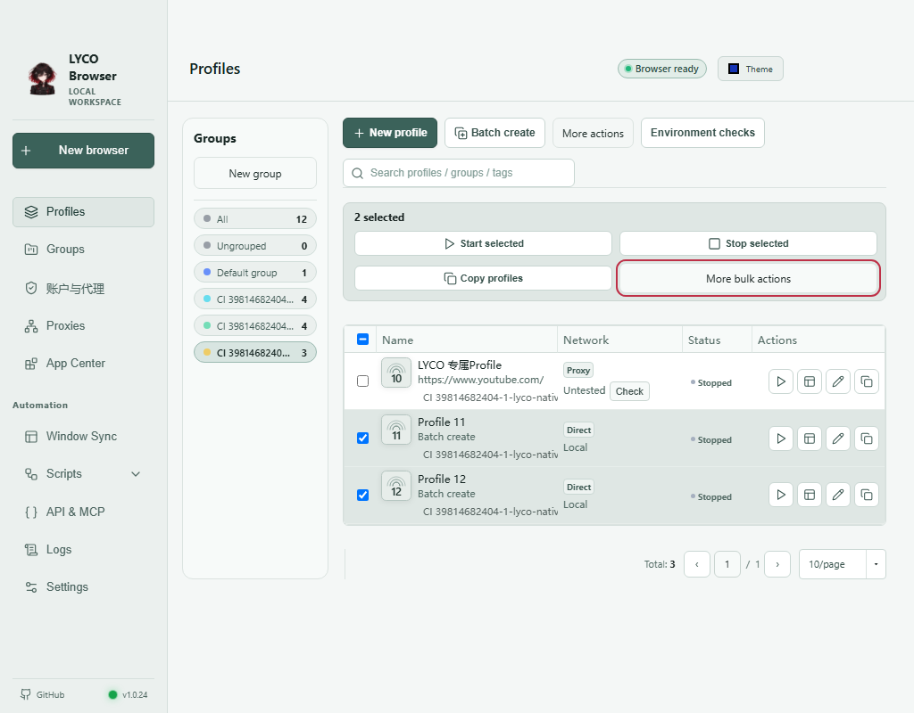
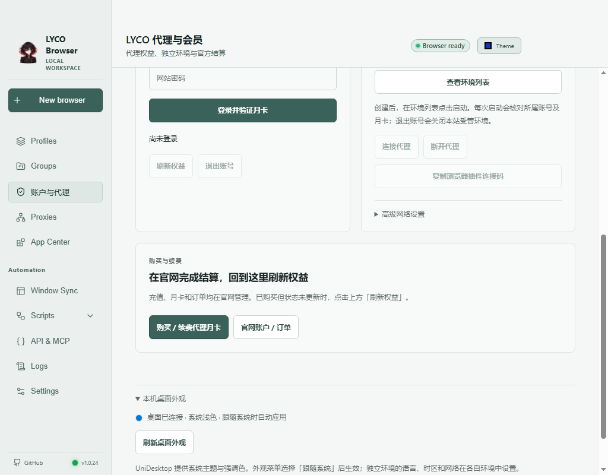

# LYCO Browser · 多环境桌面浏览器

**Windows x64 预览版已发布。** 独立环境、分组与批量操作、代理与会员、深浅主题，以及在所选环境内打开的检测入口。构建、打包和产品验收全部在 GitHub Actions 执行。

## 下载与开始使用

[Windows 预览版发行页](https://github.com/lilyco-42/lyco-browser/releases/tag/review-46d7fde745a1-39814682404-1)

| 文件 | 用途 |
| --- | --- |
| [Windows x64 安装 EXE](https://github.com/lilyco-42/lyco-browser/releases/download/review-46d7fde745a1-39814682404-1/LYCO-Browser-Windows-x64-MVP.exe) | 首次使用，安装到自己的电脑 |
| [Windows x64 便携 ZIP](https://github.com/lilyco-42/lyco-browser/releases/download/review-46d7fde745a1-39814682404-1/LYCO-Browser-Windows-x64-MVP.zip) | 解压后使用 |
| [SHA256SUMS.txt](https://github.com/lilyco-42/lyco-browser/releases/download/review-46d7fde745a1-39814682404-1/SHA256SUMS.txt) | 与下载文件核对 SHA-256 |

EXE SHA-256：`4563dde26cede3f4a3a636d0e12b2bff9304d20c9eeefa8a9de8046fd1fbd74c`

ZIP SHA-256：`b3530f515ae539f0f0c500d5d473782525f286fd5c189a49feafcbe063cc4b53`

此入口固定到已验收的产品源提交 `65b51acdbf5bb7e8c2273ea219c82b3cb0547463`，实际测试合并提交 `46d7fde745a1fe6fcaa5054fbd526f5c0952eb45`；[PR #24](https://github.com/lilyco-42/lyco-browser/pull/24) 已合并，main 合并提交 `3c03a10` 与测试提交内容树一致。下载不会随其他平台或文档版本漂移。可用 `Get-FileHash .\LYCO-Browser-Windows-x64-MVP.exe -Algorithm SHA256` 核对。

1. 下载并安装或解压，打开 **LYCO Browser**。
2. 如需使用本站线路，在 **LYCO 代理与会员** 登录已有网站账号并核对代理订阅。也可通过环境编辑器配置自有代理。
3. 本站月卡用户点击 **一键创建专属代理环境**；购买或续费由你主动打开[官网商城](https://lain42.top/shop/#proxy_1m)完成。
4. 在环境列表双击启动。点击 **环境检测** 可选择运行中的环境并打开对应检测页。



[完整 Windows 验收](https://github.com/lilyco-42/lyco-browser/actions/runs/39814682404)通过原生预检47项、便携包47项、实际安装后46项及6项安装/图标/快捷方式/卸载检查。包括并行环境、普通新标签与内嵌页面首段脚本、恢复会话、代理流量、Cookie/localStorage 隔离、身份缓存保护、UDA 外观和独立检测。截图为此包实际安装窗口，原始来源见[截图记录](docs/images/installed-workbench-65b51ac.source.json)。

本版修复了普通新标签及内嵌页面首次读取显卡信息与环境配置不一致的问题，保留已保存的身份缓存和噪声种子。旧 `ci-12ae5a9377ba` 包存在新标签首脚本身份问题，不再作为默认下载。

**验收边界：** 这是尚无商业代码签名的 Windows 预览版。HTML Canvas 与 OffscreenCanvas 跨 API 像素不保证相同；第三方检测不保证匿名、防封或官方账号准入；CI 支付为受控夹具，没有真实扣款。详见[兼容性](docs/FINGERPRINT-COMPATIBILITY.md)、[独立检测矩阵](docs/FINGERPRINT-TEST-MATRIX.md)和[网络验收](docs/NETWORK-ACCEPTANCE.md)。

macOS Apple Silicon、Linux x64 的 main `3c03a10` [构建与打包检查已通过](https://github.com/lilyco-42/lyco-browser/actions/runs/39822114627)，尚未完成对应原生 UI 验收，不将 Windows 结果套用于其他平台。Windows main 的独立重建记录见[Actions39822114943](https://github.com/lilyco-42/lyco-browser/actions/runs/39822114943)，其状态以该运行实际结果为准。

> **运行及随包资源分发授权已确认（2026-10-17）：** 产品所有者明确确认既有 Wayfern 书面授权涵盖 LYCO 运行、分发及随包 Windows/macOS 字体资源再分发，桌面工作流解除草稿分发限制。此记录依据所有者确认，不公开授权文件或商业条款，也不向其他项目授予相同权利。当前提交必须通过对应 Actions 门禁后才发布 CI 预览包；第三方版权、许可与源码来源继续保留，旧草稿不会自动发布。

候选内核仅通过独立的 `audit-kernel-archive.yml` 执行静态审查：锁定来源、版本及 SHA-256，记录字体、版权文件和公开补丁，不启动浏览器，不上传候选二进制。审查成功不等于获得分发许可，也不等于功能等价。

## 环境工作台

参考[紫鸟官方工作台说明](https://www.ziniao.com/help/docs/Overview/hot/new-workbench-tutorial)的简洁/完整信息展示，以及[站斧（战斧）官方帮助](https://www.zhanfubrowser.com/help)的新建、绑定网络、启动流程，使用 LYCO 现有环境、代理和账户后端独立实现。分组在左侧，新建和批量添加默认使用当前分组；列表默认显示环境、网络、状态与操作，可展开详细列。右键菜单支持键盘导航和 Escape 关闭。当前界面使用语义 HTML/CSS/JS，并非 React/shadcn 组件；不复制其他产品的代码、图片或标志。

批量选择栏首层保留启动、停止、复制与更多四项入口；偏好、网络、移动分组和删除放在更多面板，继续调用原有操作。账户引导、紧凑/详细列表、检测弹窗及深浅主题已包含在上述 Windows 验收中，不代表具备参考产品的全部团队功能。

Windows 安装器使用 LYCO Browser 名称、独立安装目录、开始菜单/桌面快捷方式及卸载登记，保留原程序二进制名称和第三方声明。原创 LYCO 图标随应用、安装器和卸载程序打包；实际安装到含空格目录、安装后运行、卸载保留用户数据及不修改上游登记均已在本版通过。

## 核心能力

### 环境检测

启动一个环境后，在环境列表点击 **环境检测**，选择正在运行的环境，再选择
Claude、GPT / Codex、DNS 或 WebRTC。网页会在所选环境的新标签中打开，沿用
该环境的代理、语言和时区；环境已停止时会提示重新选择，不自动换用其他环境。
检测页面由 Net.Coffee 提供，结果仅供诊断，不能当作平台账号准入承诺。
公网验收也通过这个真实界面操作，保留原始页面和未知结果，详见[检测范围](docs/NETWORK-ACCEPTANCE.md)。

### 桌面外观

UniDesktop/SDK 提供系统主题与强调色。在外观菜单选择“跟随系统”后使用系统主题，
显式选择深色或浅色优先。账户页的“本机桌面外观”可查看状态和刷新；暂不可读时
保留现有外观回退。SDK 仅提供桌面外观，不更改浏览器语言、时区或网络出口；
本版三个 Windows 阶段的实际主题、手动覆盖及许可打包均已验收，见[集成记录](docs/DESKTOP-UDA.md)。



### 浏览器与账户

- 基于 [OpenBrowser](https://github.com/sheying2013/OpenBrowser) 固定提交 `5fa3b9d0bd218a948da15820b35fe598c362eba0` 集成已有的 Chromium 多环境隔离、指纹配置、代理库、扩展、自动化/API & MCP。参考紫鸟、战斧的多窗口管理产品体验，不复制其品牌或私有实现。
- LYCO 专属「代理与会员」页面：网页登录 `https://lain42.top/studio/api/login`，通过 `/me` 确认有效 `proxy_1m` 权益，获取对应官网订阅，再使用官方 Mihomo 开启 `127.0.0.1:<随机端口>` HTTP 代理。
- **断开即停**：本地配置启用 `allow-lan=false`、禁用外部 controller；关闭时尝试停止受管 Mihomo，清理临时配置。推荐使用“一键创建专属代理环境”，自动选择本地代理；受管环境每次启动核对账号和月卡，并自动重绑定端口。手动导入仍可使用。
- 官方结算：打开现有商城 `https://lain42.top/shop/#proxy_1m`，订单、充值、支付宝/爱发电与积分兑换全部由线上 Billing 负责；**客户端不提交充值成功声明，也不含服务端秘钥**。
- JWT 只保存在 Electron **主进程内存**中，关闭程序后需要重新登录；密码不写入磁盘。没有已付款且有效的权益不能连接。
- 全部浏览器和代理联动是 MVP，不承诺自动绕过网站风控、100% 防关联或匿名性，请遵守目标网站的平台规则。

## 唯一编译与测试入口

GitHub → **Actions** → **Build LYCO Browser (Windows x64, GitHub Actions ONLY)** → **Run workflow**。

工作流：
1. 从指定不可变 SHA 获取 OpenBrowser 和 Windows 浏览器内核（保留第三方版权）；
2. 仅在 Actions 将 `src/` 和 `scripts/apply.js` 注入 OpenBrowser 源码；
3. GitHub Windows Runner 运行 JS 语法检查、`node --test`、OpenBrowser 官方安全/环境测试；
4. 从 **MetaCubeX/mihomo 官方 GitHub Release v1.19.32** 下载 Windows x64 内核；
5. 在 GitHub Actions 执行 NSIS 和便携包构建，并通过 `gh release upload` 上传 `LYCO-Browser-Windows-x64-MVP.zip`、`.exe` 到该提交的 **GitHub CI Prerelease**。

> GitHub Actions Artifact 存储配额不足，所以改为**每个提交对应的 GitHub 预发布版**（`ci-<SHA前12位>`）直接托管二进制；仍然只是内部测试构建，不代表正式上线或完成支付 E2E。

## 源码结构

```
src/network.js       # Billing、权限、订阅、Mihomo 代理；仅主进程执行
src/ui.js            # 页面交互（受 preload/IPC 严格隔离）
src/view.html        # 会员、代理和官方支付卡片
scripts/apply.js     # GitHub Actions 向 pinned 上游源码注入集成
tests/network.test.js
.github/workflows/build-windows.yml
```

安全审计与剩余限制参见 [Managed Proxy Privacy Boundary](docs/SECURITY.md)。受管代理启用拒绝直连降级，但不承诺全设备 VPN、WebRTC/DNS 零泄漏或绕过平台检测。

## 权限与网络边界

- 代理必须**明确分配给环境**：推荐“一键创建专属代理环境”；仅对创建的受管环境绑定代理，不修改其他 profile。
- 付款必须由 **Billing 服务端校验**，客户端不直接对接支付商户凭据或提供后台管理员 API。
- 本地端口可能变化，受管环境会在启动时自动重新绑定；手动导入的旧环境仍需自行更新。批量启动共用同一次核心连接；退出或过期不会留下受管核心。
- OpenBrowser 依赖的浏览器内核/扩展需要独立审计。支付与代理业务会话请使用最小权限。

## 许可和归属

- 上游 OpenBrowser 仓库根目录声明 MIT：版权与授权请见 [OpenBrowser/LICENSE](https://github.com/sheying2013/OpenBrowser/blob/main/LICENSE)。
- 上游的 `native-input-mirror.cs` 引用了来自 **chrome-power（AGPL-3.0）** 的实现；保留上游的 `Browserapp/THIRD-PARTY-NOTICES.md`、`Browserapp/LICENSE.chrome-power.txt` 和对应源码，商业分发前应专门评估 AGPL 义务。
- 集成使用的 Mihomo 项目来自 [MetaCubeX/mihomo](https://github.com/MetaCubeX/mihomo)，原始许可证及内核再分发条款以对应上游仓库为准。不得移除上游浏览器内核和第三方的 LICENSE/NOTICE。
- LYCO 特定代码只是集成层，不代表整个复合安装包已经通过商业闭源分发的法律合规审核。


## 五平台发行开发（PR #31）

共享源码在 `apps/universal/`，使用 Expo SDK 56 / React Native 0.85，包含官网登录、有效月卡检查、官网购买与续费入口、环境元数据持久化及原生移动浏览环境。网站 JWT 仅保存在应用内存；网页没有账户或代理凭据桥接接口。当前工作仍在 [PR #31](https://github.com/lilyco-42/lyco-browser/pull/31)，尚未完成五平台商业发行，验收记录与待办见[发行进度](docs/ALL-PLATFORM-READINESS.md)。

| 目标 | 应用 | 浏览环境隔离 | 浏览代理 | GitHub Actions 目标 |
|---|---|---|---|---|
| Android 9+ | RN/Expo APK | System WebView 环境专用数据目录、独立浏览进程 | 源码构建 sing-box；官网线路或自备 HTTP(S) | `build-universal.yml / android` |
| iOS 17+ | RN/Expo 原生 App | WKWebView 独立持久 WKWebsiteDataStore | 源码构建 sing-box；带本机随机认证的 SOCKS5，回环目标绕过问题未解决 | `build-universal.yml / ios-simulator` |
| Windows x64 | OpenBrowser 桌面版 | Wayfern 独立环境与保存身份 | Mihomo 绑定独立环境 | `build-windows.yml` |
| macOS ARM64 | OpenBrowser 桌面版 | Wayfern 独立环境与保存身份 | Mihomo 绑定独立环境 | `build-desktop-unix.yml` |
| Linux x64 | OpenBrowser 桌面版 | 随包 Chromium 独立数据目录 | Mihomo 绑定独立环境 | `build-desktop-unix.yml` |

Android 一次打开一个环境，关闭时结束浏览进程，防止旧 worker 沿用其他环境的代理。iOS 在建视图前给环境数据存储配置代理并关闭 failover；独立原生复现仍观察到本机目标直连，因此这项配置不足以证明故障时禁止直连。官网线路在启动前核实账号与有效月卡，原生层定期续验，失效或超过核实期限后停止。支持的订阅协议与实际测试范围以当前 Actions 为准，不能从编译成功推断所有节点均可连接。

移动端提供原生地址栏、前进后退与刷新。环境列表的“清除网站数据”保留环境条目，“删除环境”在原生清除成功后删除条目，均由用户确认；其他环境的数据保留。Android 使用公开 API 设置环境自有的数据与缓存根，浏览进程停止后删除该根。Android 已签名候选已通过 A/B Cookie、localStorage、IndexedDB 隔离、清除与删除的完整原生验收；iOS 同样通过存储流程，但代理故障负向未通过，见[发行进度](docs/ALL-PLATFORM-READINESS.md)。

**能力边界：** 移动端独立网站数据与浏览代理不能等同于独立硬件指纹、全设备 VPN 或 WebRTC/DNS 零泄漏。RN Web 产物是会员管理控制台，不能代替三个桌面应用；不同内核的指纹能力分别验收。代理故障直连、DNS/IPv6、真机与商业发行门禁仍需完成。

**支付合规：** 测试版可打开官网商城；Apple App Store / Google Play 正式上架时需按适用地区及类别检查应用内数字商品支付和外链政策，不能默认允许绕过商店支付限制。

**构建边界：** `npm install` / Expo prebuild / TypeScript check / Gradle / Xcode / macOS DMG / Linux tar.gz / Windows EXE 的构建和运行只能发生在 GitHub Actions runners。AgentDock 只处理版本管理、编辑、提交，不在设备/生产服务器上编译或执行。

Android 默认构建打包 JS 的独立预览 APK；签名候选通过手动工作流使用保留的 LYCO 密钥，运行门禁通过后仅留候选 Artifact。iOS 可构建未签名模拟器 App 和独立的 iPhone ARM64 设备归档；设备 IPA 尚无有效签名，不能直接安装，真实设备和商店分发仍需有效 Apple 签名资格。macOS 签名公证、Windows 商业代码签名和商店账号尚未完成。**不要把 CI 检查等同于真机验收、商店上架或真实付款。**

## 路线

首版：Windows x64、独立环境、已有账户授权、官网支付跳转、本地代理绑定和 Actions 交付。

后续候选：恢复登录（DPAPI 加密）、在线续费/订单状态回调、私有团队环境同步与权限模型。它们不在本次 Windows 预览验收范围。

## 浏览器扩展（开发版，以对应提交的 Actions 验收为准）

扩展代码在 `extensions/lain42/`，与桌面版共用网站账户和已有月卡，不新增自动扣费。它负责 Chrome / Edge 的网页代理；独立存储和指纹环境仍由桌面客户端管理。

使用当前提交通过 Actions 后生成的 `LYCO-Subscription-Extension.zip`：解压，在浏览器扩展管理页开启开发者模式并“加载已解压的扩展”。目前尚未提交 Chrome / Edge 商店，不能当作商店一键安装版本。

在桌面版“代理与会员”连接后点击“复制浏览器插件连接码”，粘贴到扩展并明确启用。私有 `lyco-fingerprint-browser` 可在已运行的本人专属环境“更多”菜单复制同一格式的 SOCKS5 连接码。连接码只有本机地址、端口和最长八小时的有效期，不含账户 JWT、节点口令或订阅令牌。

扩展不读取 Cookie、历史记录或网页内容。仅声明代理、会话存储和定时器权限，不请求任意网站访问权。客户端停止时不加入直连备用线路；连接码过期或浏览器重启丢失会话时暂停受管代理，用户可以重新导入或明确关闭，恢复浏览器原来的代理设置。扩展不会覆盖其他扩展或系统策略正在管理的设置。

Actions 同时运行协议/权限/到期回归，以及真实 Chromium 的扩展加载、启用代理、测试站点流量、核心停止、过期暂停和恢复原设置验收。测试不会创建真实订单或读取真实用户凭据。通过当前主分支全部门禁后才发布 ZIP 与校验值。

## 网站订阅专属环境（本轮开发）

“代理与会员”新增一键创建专属代理环境：登录已有网站账号、核对代理订阅后自动启动内置 Mihomo、在代理库保存本地线路并创建已选好代理的独立环境。再从环境列表点击启动即可，不需要用户记端口或手动绑定。

专属环境记录所属网站账号；每次启动重新核对账号和月卡，并自动更新重连后的本地端口。切换到其他网站账号或月卡失效时拒绝启动该环境；退出或断开会关闭受管窗口。已知月卡到期会停止本地核心。手动环境及原代理库操作保留。

不增加第二套月卡、不设置新的自动扣费。购买/续费仍显式打开 https://lain42.top/shop/#proxy_1m，由网站负责确认价格、充值和发货。用户可以选择其他代理源；本站受管环境的自动绑定只适用于本人有效网站权益。

Windows Actions 增加实际打包后的原生窗口验收：测试专属账号登录、代理绑定、真实 Mihomo 和内置 Chromium 的本地测试流量、跨账号启动拒绝和权益失效断开。Billing 只使用 CI 测试响应，不会创建真实订单，不能将它称作真实商户付款成功。预发布版本必须通过当前提交的验收。

图标复用已由内置 imagegen 生成的 Lyco 原创图，来源/许可在 resources/branding。ICO、ICNS 只在 Actions 转换，Windows EXE 使用包构建器的图标嵌入流程，原上游和 Mihomo 的版权说明继续保留。
