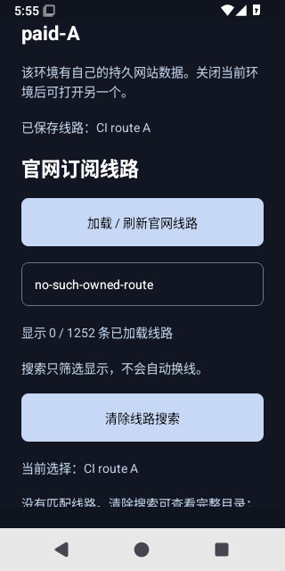

# 移动环境保存官网线路

`655e071` 在 Android/iOS 共享控制界面中加入逐环境官网线路绑定。登录后加载线路，明确选择节点，再保存或打开；以后加载目录保留该环境所选线路。原有 Cookie、localStorage、IndexedDB 的数据空间继续使用原 UUID。移动端仍一次打开一个原生环境。

绑定只保存网站账号、节点的不透明 SHA-256 标识和显示名称。标识来自节点名称、协议、服务器及端口，不包含密码；密码轮换不会改变所选节点。节点更名或端点变化视为新节点，原选择保留，要求用户重新选择。订阅正文、节点凭据与网站令牌不写入环境元数据。

## 启动和迁移

保存或启动都重新读取官网账号、权益及节点目录。必须是所属账号、当前仍存在的准确节点、尚有效的五分钟核实租约。切换账号后隐藏其他账号的已绑定环境，启动、清除和删除也检查归属。已经绑定官网线路的环境不能用自备代理入口绕过；无绑定的旧环境继续支持自备 HTTP(S) 代理。

更换线路前关闭当前原生环境，先成功写入绑定，再提交原生启动。异步排队期间的关闭、返回、切换会话会使待启动操作失效。线路缺失、启动失败或断线均不自动挑选其他节点或系统浏览器。原生权益轮询继续执行，网页无法修改该租约。

同一个 AsyncStorage 键使用 `LYCO_PROFILE_METADATA:2` 加换行的版本封装，绑定与 UUID 一次写入。新版接受原有未绑定数组，保留有效 UUID；无效的新版记录拒绝读取并保留原数据。旧版的 JSON 读取器会拒绝封装，不能忽略绑定后覆盖列表。实际旧/新 APK 升级、降级拒绝覆盖及恢复安装已在下述 Android 原生场景验证。

## 当前验证范围

- [40676034809](https://github.com/lilyco-42/lyco-browser/actions/runs/40676034809) 已通过八项新增策略/迁移测试、现有移动测试、TypeScript、Web 导出与离线许可页浏览器回归。
- 同源码签名 Android [40676041190](https://github.com/lilyco-42/lyco-browser/actions/runs/40676041190) 已通过原有完整原生存储、导航、重开、清除、删除、进程退出、真实代理正负向和许可页验收。实际 APK SHA-256 为 `338718ad3c29a51599579af12b5c7ef2ea8bc321de35485704e39227d35637f5`。新增官网绑定另由 [40709909923](https://github.com/lilyco-42/lyco-browser/actions/runs/40709909923) 对同一个未修改签名 APK 完成整组 12 项检查与 7 份实际源站观察。
- iPhone 设备编译 [40677110486](https://github.com/lilyco-42/lyco-browser/actions/runs/40677110486) 成功，IPA SHA-256 为 `27e87797aabd8a74edbc22bbb27c7cb72225e08dc35d4d482d7d1a137133ab92`；未签名、不可直接安装，没有真机运行证明，既有 iOS 路由问题仍未解决。
- 新增验收使用 API35 一次性模拟器与隔离 Billing，不修改 APK、生产 API 或应用 TLS 配置。先验证默认 TLS 拒绝未信任的 CI 证书，再仅向模拟器添加临时 CI 根；原生浏览流量通过两个认证上游，同源服务器按实际 TCP 连接归属记录 Cookie/localStorage/IndexedDB。上游停止时保持直连及系统代理对照可达，以发现任何错误回退。原始数据库和 CI 私钥不进入工件。
- 原生场景覆盖：旧版建立数据再升级，保存/打开 A 与 B，强制停止并重新登录恢复 A，目录移除 A 后保留绑定并禁用启动，停止 A 后无回退且 B 可用，A 明确换 B 后三类网站数据仍属于 A，另一账号隐藏两个绑定环境，实际旧版拒绝新版记录且保存禁用，恢复新版仍使用 B 并保留 A 数据，原生守卫读取撤权响应后销毁 WebView。四份实际环境元数据证明保留 UUID；绑定完成、降级后、恢复后摘要完全一致。
- 共享夹具 [40680509690](https://github.com/lilyco-42/lyco-browser/actions/runs/40680509690) 回归成功：Windows/macOS/Linux 各 54 个单元门禁、5 个普通与 8 个链式真实 Mihomo 检查。此项不是三平台原生成品新增通过证明。
- 加入 Android RTC 配置策略后的 `ced08fe` 原签名包，原有原生 [40721798567](https://github.com/lilyco-42/lyco-browser/actions/runs/40721798567) 和官网绑定 [40724969665](https://github.com/lilyco-42/lyco-browser/actions/runs/40724969665) 回归均成功，后者仍为整组12项、7份实际观察。APK SHA-256 `3b8ba20629c1f8d9d0661318740938c31ab7225f4624fde5b91e1be6c9995038`；同包扩展 RTC [40724556782](https://github.com/lilyco-42/lyco-browser/actions/runs/40724556782) 明确失败，初始/嵌套空帧仍绕过策略，不能作为完整网络保护通过。

以上不涵盖客户公网出口、真实付款、全设备 VPN、完整 DNS/IPv6/RTC 或商店发行。全部产品构建、测试与运行只在真实 GitHub Actions 执行。

## 完整线路目录搜索

移动官网线路页增加名称、已有地区文字和协议搜索，多个词同时匹配；显示筛选数与完整已加载数。清除恢复完整目录，搜索和清除均不保存、不启动、不改变所选线路。被筛掉的已选节点仍单独显示；失效/缺失节点继续拒绝启动，跨账号或切换环境清除搜索。

新增真实 Android 验收保留原有整组 12 项、七次源站与存储观察，再加入 1252 条受控目录的筛选、零结果、清除和所选节点保留检查。1250 个目录别名共用自有 A 入口，不是 1250 个独立健康出口；比较实际 AsyncStorage 前后内容摘要并要求源站访问数不增加。新 [41563675880](https://github.com/lilyco-42/lyco-browser/actions/runs/41563675880) 已完成保留证书签名和原有完整原生回归：6 份网站存储观察、5 次导航及代理正负向、许可页均通过。实际 APK 为 129826975 字节、SHA-256 `e9852bc90bec63f28405d3c08c1c576db4fc48018705d76fd8c6941783556e57`，原始 ZIP、APK、签名和版本证据均已完整核验。新增 [41586183938](https://github.com/lilyco-42/lyco-browser/actions/runs/41586183938) 对同一未修改 APK 的整组 13 项检查已通过，含原有 12 项及新搜索，7 次源站与三类存储观察保持正确。1252 条目录的筛选、零结果、清除与选择保留均已实际操作；搜索前后真实保存记录摘要一致、额外源站访问为 0。原始证据 ZIP 为 1454964 字节、SHA-256 `78ac6862750a108720ec50da694c89b6447a2ac37bb93b9f1a2b60d6fd51518f`，大小、摘要及 CRC 完整核验；不声称 iOS 路由或 RTC 已通过。

同一界面的 iPhone ARM64 设备归档 [41586547941](https://github.com/lilyco-42/lyco-browser/actions/runs/41586547941) 已成功：SDK26.5、最低iOS17、1.0.25/build2，原始归档和实际 Mach-O iPhoneOS 平台、离线 JS 及版本均已核对。IPA SHA-256 `35a517993f72551317978944ab41ae30e195b7b894e8b2bf28b19096df1fd999`。该包未签名、不可直接安装，没有真机或 iOS 搜索运行证明，原 iOS 代理失败保留。

下图为同一签名包在自有测试目录中零结果时保留选择的原始界面；1250 个条目为同一上游别名，不表示 1250 个独立健康出口。来源见[截图记录](images/mobile-route-search-5654cf5.source.json)。

## 编辑名称与首页（待验证）

移动环境列表新增独立编辑表单，保存只修改名称和下次打开的首页。环境 UUID、创建时间、所属账号及官网线路保持；取消不保存，输入不合法或保存失败保留原记录。编辑入口沿用账号归属检查，保存前校验并停止旧浏览进程，随后仍通过原有绑定与权益流程打开。没有复制、清空或迁移网站数据；环境记录继续使用原有 v2 封装和同一存储键。保存也拒绝超过既有读取上限的记录，避免成功写入后无法重读。

新增源码测试检查不可变身份、网址及绑定校验和往返恢复；实际签名 Android 验收将在原有 13 项与 7 次浏览/存储观察之外，增加编辑取消、非法输入、名称/首页保存、进程重启后沿原线路打开、三类网站数据保持、B 不变及原元数据恢复。新首页额外产生 1 次明确标识的真实浏览，原 7 次分别保留；原有断线、升级/降级和跨账号门槛不变。新签名包 [41594819546](https://github.com/lilyco-42/lyco-browser/actions/runs/41594819546) 已通过类型、策略及原有整组原生验收；实际 APK 为 129832443 字节，SHA-256 `39ed9dee059fa945447571f18321de32d12aaac001e278e12cba25ba02045972`，完整原始 ZIP、签名、版本和 APK CRC 已核验。新增编辑的同包验收 [41596731418](https://github.com/lilyco-42/lyco-browser/actions/runs/41596731418) 已失败：取消后编辑框仍在，尚未执行保存与重启证明。完整 965108 字节原始 ZIP、摘要与 CRC 已核验。原始截图与层级记录显示取消按钮被滚动视口裁切，而驱动点击其视口外的文字；不将此误报为环境条目丢失。`cf28631` 修正将保存、取消及错误提示移到独立底部操作区，并新增取消/保存后表单消失断言；新签名构建 [41597936723](https://github.com/lilyco-42/lyco-browser/actions/runs/41597936723) 已通过类型、24 项策略及原有整组原生验收；实际 APK 为 129832611 字节，SHA-256 `7010942e5e550baf9fd84d767c831c6aa30eebefcc27ce55595027cf953a757d`，完整原始档案、APK CRC、版本及保留证书均已核验。同包新增编辑复验 [41600136374](https://github.com/lilyco-42/lyco-browser/actions/runs/41600136374) 已失败；修正后 iPhone 构建 [41600149916](https://github.com/lilyco-42/lyco-browser/actions/runs/41600149916) 已编译成功，其不同范围见下文终态记录。iPhone 未签名设备归档 [41596754756](https://github.com/lilyco-42/lyco-browser/actions/runs/41596754756) 已编译成功，但属于底部修正前源码；完整原始候选 ZIP（22967397 字节、SHA-256 `19e4deb4190c8f7e2c071be0b87fb5b898eab62b4f6a8f4452db9eec98329a67`）、声明 ZIP 和 IPA 均已核验大小、摘要及 CRC；实际 ARM64/iPhoneOS、版本和离线 JS 一致。IPA 为 23184150 字节、SHA-256 `f1f761c33e77b59036a55feac17c97dd73e87b803c47045adfe1a7fb6eba6670`。仍未签名、不可直接安装，没有真机或 iOS 路由通过证明。

The footer candidate's follow-up [41600136374](https://github.com/lilyco-42/lyco-browser/actions/runs/41600136374) passed cancellation, invalid-input, first save and process-reopen flows, but failed restoring the original homepage. Original screenshots/hierarchy show a retained URL suffix after cursor-relative erasing; this invalidates exact-homepage proof even though the first navigation succeeded. The full 1266992-byte original ZIP, SHA-256 `ca151fd014ed444bb066a1bf524ef79c879bf3c8fc7b515b87dc5c696397c5b8`, is verified. Test source `82edff8` selects the complete field, reads back exact equality and explicitly dismisses the keyboard before saving, using the documented [erase/select behavior](https://docs.maestro.dev/reference/commands-available/erasetext) and [UI text readback](https://docs.maestro.dev/reference/commands-available/copytextfrom). That test-only change preserved APK bytes and all original gates. Same-APK [41745820186](https://github.com/lilyco-42/lyco-browser/actions/runs/41745820186) failed the first cancel before reaching the new text helper. Its complete 1001442-byte original ZIP, SHA-256 `b20584f6f9b92c3235368dcfa74820189e960286f2b135a6e3a3c05a3ee7685f`, has verified size, SHA and CRC. Maestro recorded changing cancel bounds while the keyboard closed, then a touch outside the final button. This is not evidence that the cancel handler ran or that a profile disappeared.

The current Android-only correction disables the editor's JS keyboard-height adjustment: React Native 0.85.2's [native Modal](https://github.com/react/react-native/blob/v0.85.2/packages/react-native/ReactAndroid/src/main/java/com/facebook/react/views/modal/ReactModalHostView.kt#L329) already selects `SOFT_INPUT_ADJUST_RESIZE`, while [KeyboardAvoidingView height mode](https://github.com/react/react-native/blob/v0.85.2/packages/react-native/Libraries/Components/Keyboard/KeyboardAvoidingView.js#L235) separately changes its height. The duplicate adjustment is a candidate explanation for the observed moving target, not a proven sole cause. iOS retains padding; all editor and original native assertions remain. The new signed producer [41748283716](https://github.com/lilyco-42/lyco-browser/actions/runs/41748283716) passed all six original native flows, six storage reports and five navigations. Complete original candidate/native/notices ZIPs, SHA/CRC, APK CRC, compiled version and retained certificate have been verified. Its APK is 129832635 bytes, SHA-256 `9192e9467365a2900fa7b50d9c9808578b69ca63f2684a0ffaa505380136f244`. The unchanged-APK editor consumer [41750970407](https://github.com/lilyco-42/lyco-browser/actions/runs/41750970407) passed cancellation, invalid-input checks and exact name replacement, then failed before exact URL readback or saving. Its full original 1212824-byte ZIP, SHA-256 `47c84f68519aa5ec57f0661fc4149a1b610b421743499928761dc3def5d3b4cc`, is size/SHA/CRC verified. Original device logs show no keyboard-show request for the URL long press; the later explicit Back coincides with modal dismissal. The failure screenshot was taken after that dismissal. Pinned [Maestro 2.11.0 AndroidDriver](https://github.com/mobile-dev-inc/Maestro/blob/cli-2.11.0/maestro-client/src/main/java/maestro/drivers/AndroidDriver.kt#L490) unconditionally sends Back for hideKeyboard, consistent with the [official command description](https://docs.maestro.dev/reference/commands-available/hidekeyboard). The driver now first taps the field before selecting and uses the product's Enter submit handler instead of Back. APK bytes, exact full-field equality and all 14 checks, seven original observations plus one edited-homepage observation remain required. Same-source iPhone [41751004975](https://github.com/lilyco-42/lyco-browser/actions/runs/41751004975) is tracked separately; no iOS runtime claim.

The footer's iPhone [41600149916](https://github.com/lilyco-42/lyco-browser/actions/runs/41600149916) completed successfully. Full original candidate/notices ZIPs, IPA SHA/CRC, ARM64/iPhoneOS platform, actual version and offline JS have been checked. IPA: 23184167 bytes, SHA-256 `1ad3d985e0b4e6e6e624459919e00de65ddb02673d876337723fda6b091058e8`. It remains unsigned, not directly installable and without device-runtime or iOS routing acceptance.
